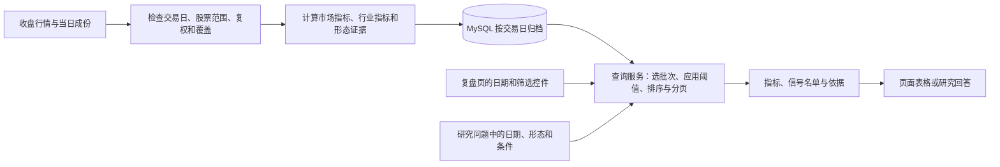

# A 股复盘核心框架

本设计用于实现与评审。系统要回答三个逐层深入的问题：选定交易日的市场环境如何，强股集中在哪些方向，按我的阈值有哪些个股值得复核。阅读入口是热点页的“强势股复盘”和研究区的“A 股强势股复盘”技能。两处以同一个交易日、同一版证据回答。原文解读、详细公式及既有样本见[复盘设计与指标字典](./A股强势股复盘设计.md)。

## 一次复盘的数据流

**收盘时计算，提问时筛选。** 行情采集器处理交易日、来源、有效成份和复权。计算器生成可重放的数值证据。查询服务负责将参数变为结果。修改“大阳下限”只需重新比较归档里的实体涨幅。修改 EMA 算法、复权基准或平台天数的定义，则需要新的证据版本。

## 三层分别交付什么

| 层级 | 输入与计算 | 用户能查到什么 |
| --- | --- | --- |
| P0 市场 | 当天涨跌幅、有效成交窗口和当日沪深 300 成份。上涨按涨跌幅大于零，一年新高按最高价严格突破此前 249 根，50 日占比按收盘严格高于含当日 MA50 计算。 | 三个指标、有效分母、命中名单、排除原因以及较上一交易日的变化。 |
| P1 方向 | 容量取当日行业成份与百日新高名单的去重交集。强度取行业指数相对第 20 个交易日前收盘的涨幅。风格对比近期新高指数和平均股价指数，并展示 EMA5、EMA13。 | 行业排名可下钻到股票。强度记录起止日、来源和计算方法。若采用 20 个已公布日收益连乘，标明方法和舍入影响；缺任一天就显示缺数。 |
| P2 个股 | 收盘后生成上涨中继、EMA5 小平台、EMA5 大平台、EMA13 回踩、超跌回踩五类结构证据。规则记录大阳锚点、观察天数、价格和均线的比较基准。 | 调整阈值后得到候选或触发名单，展开一行可看信号日期、参考大阳日、形态依据和个人题材备注。 |

P1 和 P2 可以分开发布。一个交易日可能已有市场摘要，行业强度仍待核对。页面与研究回答都应区分三种情况：该项尚未发布、已发布但部分字段缺失、完整有效的查询命中零条。

## 数据库保留什么

| 现有表 | 留存内容与关联 |
| --- | --- |
| `market_review_days` | 日期、上一交易日、口径、批次、来源、覆盖数、各指标分子分母。日期用于导航，批次用于复现。 |
| `market_review_members` | 以归档日记录 ID 和证券代码关联当日身份、关键价格、均线或前高、命中结果、排除原因。 |
| `market_review_studies` | 以归档日记录 ID 和专题类型关联风格、行业和形态证据。行业保存排名依据与命中股票；形态保存数值证据，支持在读取时改变阈值。 |
| `market_review_notes` | 按用户、候选日期、证券代码保存个人备注及填写时间。历史回放中单独展示填写时间。 |

原始下载文件和计算窗口可以重建，只作为计算输入。一个调参组合无需复制一套行情或名单。**待补的版本边界**是专题修订：当前同一日同一类型的专题可以更新。若要保证历史研究链接在专题修订后仍能复现，应对专题保存内容指纹，链接同时携带日批次和专题版本；相同指纹重跑直接复用。

## 候选、触发和阈值

以 D 表示候选日，T 表示 D 的下一市场交易日。

1. **D 收盘**生成结构证据。每条信号按证券、形态、锚点和候选日识别。同一证券可以命中多个形态，所以“形态信号数”和“去重股票数”应各自标明。
2. **用户调参**后，对证据应用当前参数。首版初值为大阳实体涨幅至少 5%、贴线或支撑距离至多 2%、平台宽度至多 8%、十字实体占当日振幅至多 35%、相对大阳日的振幅比至多 0.75。各形态只应用相关条件。平台检查宽度和贴线距离，上涨中继检查十字实体和振幅收缩。阈值属于工程参数，可随查询调整。
3. **T 收盘**比较 T 日与 D 日的复权最高价。严格突破才记录触发，触发记录保留 D 的锚点和筛选证据。T 当天停牌或与 D 同高，均不产生本规则的触发记录。若行情尚未到齐，T 的专题保留待发布状态。
4. **回看**时，“当日候选”按候选日查询，“当日触发”按触发日查询，并返回原候选日。查看 D 时只能看到 D 收盘当时的证据。

例如，某只股票 D 日有一条大阳实体涨幅为 6.2% 的小平台信号，其他条件都通过。大阳下限设为 6% 时入选，设为 7% 时移出。若 T 日复权最高价严格突破 D 日高点，在 6% 的条件下应能从 T 的触发名单找到这条 D 日信号。在 7% 的条件下，候选和对应触发应同时消失。这个例子可直接作为固定测试样本。

## 页面与研究提问的共同查询契约

| 查询输入 | 返回结果 |
| --- | --- |
| 交易日、日批次、专题版本 | 实际使用的日期、批次、规则版本、来源和覆盖状态 |
| 阶段、形态、证券、五个阈值 | 规范化后的筛选条件、信号总数、稳定排序的匹配行 |
| 页码与每页条数 | 当前页、总数，以及能恢复原条件的完整名单链接 |

页面控件与研究区的自然语言只负责生成查询条件。例如，用户问“11 月 19 日大阳下限 7%、贴线 1% 的 EMA13 回踩，哪些当天触发？”，查询阶段为触发，形态为 EMA13 回踩，其余参数取初值。回答应复述实际生效的参数。若问题同时问候选和触发，应分别执行两个阶段的查询；有歧义的条件应显式说明。

页面按“市场 → 行业与风格 → 个股候选”阅读；研究回答可以直达任一层。研究区摘要可只列前 10 条，但需返回完整计数，点开来源要恢复原日期、阈值、阶段和形态。两处复用仓储及筛选函数；默认值、参数别名与校验范围也应归入共享契约，避免相同问题被解释成不同筛选。

## 实现落点与验收顺序

现有[收盘同步](../server/scripts/sync_market_review.py)、[专题计算](../server/scripts/review_studies.py)、[专题仓储](../server/internal/repository/market_review_study.go)和[形态筛选](../server/internal/service/market_review_study.go)已提供主路径。两个读取入口分别在[复盘专题页面](../web/src/pages/hotspots/review-studies.tsx)和[研究专题回答](../server/internal/service/topic_research_studies.go)。应用中的技能入口是 `/research/skills`，用于选择和说明复盘能力；指标数值由归档查询提供。

| 顺序 | 验收样例 | 通过条件 |
| --- | --- | --- |
| 1. 固定查询契约 | 一个日期、一种形态、两套阈值 | 两个入口实际生效的参数相同；总数、顺序、证券、形态、候选日和触发日逐行一致。 |
| 2. 核对时间边界 | 连续两个交易日，含触发、同高、停牌三个样本 | D 日不出现 T 日结果；T 日触发可追溯至 D，严格突破条件成立。 |
| 3. 核对行业 | 一个行业换样日、一组完整 20 日指数或收益序列 | 容量与当日成份交集一致；强度可从所标来源重算；覆盖缺口能追溯。 |
| 4. 核对归档生命周期 | 重跑同一天、单个专题失败、数据源修订 | 重跑不重复计数；未完成专题状态明确；修订后旧研究结果仍能定位原证据。 |

先用小样本走通以上边界，再扩展历史覆盖。验收时分别记录“框架已定义”“代码已接入”“真实样本已核对”，便于后续查询进度。
